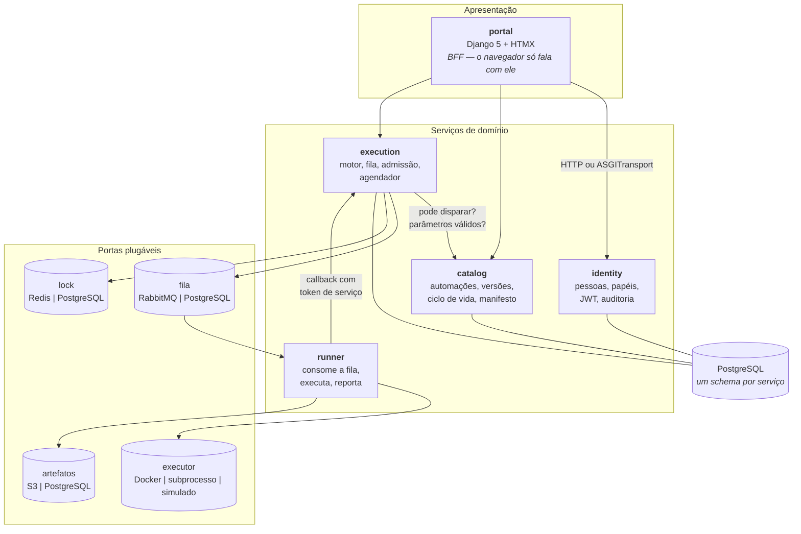

# Órbita

[](https://github.com/LuizHenriquelhlt/orbita-hub/actions/workflows/ci.yml)


**Plataforma de orquestração de automações corporativas.** Catálogo,
disparo, fila, execução isolada, acompanhamento ao vivo, artefatos, auditoria
imutável e agendamento — em quatro serviços e um portal.

O ponto do projeto não é a lista de funcionalidades. É que **o mesmo código
roda de dois jeitos**: cinco processos com RabbitMQ, Redis, MinIO e containers
Docker de verdade, ou um único processo que não precisa de nada além de um
PostgreSQL. Trocar entre os dois é uma variável de ambiente, e não existe um
`if` sobre o modo em nenhuma regra de negócio.

```bash
git clone … && cd orbita-hub
make up        # ambiente distribuído completo
make seed      # cenário fictício do INRH
# http://localhost:3000 — entre por "ver a demonstração", sem senha
```

---

## Índice

- [O problema que isto resolve](#o-problema-que-isto-resolve)
- [Arquitetura](#arquitetura)
- [O truque dos dois modos](#o-truque-dos-dois-modos)
- [As quatro portas plugáveis](#as-quatro-portas-plugáveis)
- [O contrato de plugin](#o-contrato-de-plugin)
- [Decisões que valem explicação](#decisões-que-valem-explicação)
- [O que é real e o que é encenado](#o-que-é-real-e-o-que-é-encenado)
- [Como rodar](#como-rodar)
- [Implantação](#implantação)
- [Estrutura do repositório](#estrutura-do-repositório)
- [Testes](#testes)
- [Limites conhecidos](#limites-conhecidos)

---

## O problema que isto resolve

Em uma organização de porte médio, automações nascem espalhadas: um script na
máquina de alguém, um robô em um servidor esquecido, uma planilha com macro.
Cada um tem o seu jeito de ser disparado, nenhum tem log consultável, ninguém
sabe quem rodou o quê, e quando a pessoa que escreveu sai, a automação morre
com ela.

Uma plataforma de automações resolve isso ao transformar cada automação em
**uma imagem mais um manifesto declarativo**. A partir daí a plataforma dá, de
graça e igual para todas: catálogo pesquisável, controle de acesso, fila com
prioridade, limite de execuções simultâneas, log ao vivo, artefatos baixáveis,
métricas, agendamento e trilha de auditoria.

O Órbita é uma implementação dessa ideia. O domínio é o **Instituto Nacional de
Recursos Hídricos (INRH)**, um órgão federal fictício — outorgas de uso de
água, reservatórios, superintendências regionais. Todos os dados são
sintéticos.

---

## Arquitetura



**Quatro serviços, uma regra de fronteira**: cada um tem o seu schema no
PostgreSQL e **não existe chave estrangeira entre schemas**. Se alguém
escrever um `JOIN` de `execution` para `catalog`, a migração que cria a FK não
tem o que referenciar e o erro aparece no CI — não seis meses depois, na
reunião em que se decide extrair o serviço.

O portal é um **BFF**: o navegador conversa só com ele, e o JWT nunca chega ao
JavaScript. Não há token em `localStorage`, que é o alvo preferido de XSS em
aplicação com API.

---

## O truque dos dois modos

A plataforma precisa rodar em dois lugares com restrições opostas:

| | Produção / desenvolvimento | Demonstração pública |
|---|---|---|
| Processos | 5 | 1 |
| Fila | RabbitMQ | tabela PostgreSQL |
| Execução | containers Docker | roteiro simulado |
| Artefatos | MinIO / S3 | `bytea` no PostgreSQL |
| Lock | Redis | advisory lock |
| Memória | o que for preciso | 512 MB |

A saída usual é manter dois códigos — um "modo dev simplificado" e um "modo
produção" — que divergem em um mês e passam a esconder bugs um do outro.

Aqui a saída foi outra. O `httpx` tem um transporte, `ASGITransport`, que em
vez de abrir socket chama a aplicação ASGI **em memória**. Como é um
*transporte*, ele troca a camada de transporte sem mexer na de aplicação: o
código que chama continua sendo

```python
preparo = await cliente_catalog.post(f"/automacoes/{slug}/preparar-execucao", ...)
```

e continua recebendo um `httpx.Response` com status, cabeçalhos e corpo — com
middleware, validação do Pydantic, dependências e tradução de erro todos
funcionando, porque a requisição de fato atravessa a pilha do FastAPI do
serviço destino. O que não acontece é um byte sair pela rede.

Então o modo de composição é uma linha de configuração:

```python
# hub_core/clients.py
if settings.modo_monolito:
    return httpx.AsyncClient(transport=httpx.ASGITransport(app=app_embutida))
return httpx.AsyncClient(base_url=url_do_servico)
```

**A armadilha que quase ninguém documenta:** `ASGITransport` chama a aplicação
com escopo de requisição e **nunca envia o escopo de `lifespan`**. Os eventos
de inicialização dos serviços embutidos não rodam, e a primeira requisição
falha em um engine de banco não inicializado. `Mount` do Starlette tem o mesmo
comportamento. A correção são três linhas em `gateway/hub_gateway/main.py`:

```python
async with contextlib.AsyncExitStack() as pilha:
    for nome, aplicacao in apps.items():
        await pilha.enter_async_context(aplicacao.router.lifespan_context(aplicacao))
```

Sem elas, todo o desenho não funciona.

---

## As quatro portas plugáveis

Cada dependência de infraestrutura é uma classe abstrata com ao menos duas
implementações. A que roda vem da configuração.

### Fila — `hub_core/broker/`

| Adaptador | Como obtém cada garantia |
|---|---|
| **RabbitMQ** | nativo. Atraso via filas de espera com TTL fixo por faixa |
| **PostgreSQL** | `SELECT … FOR UPDATE SKIP LOCKED`; visibilidade por coluna + recuperador; retry por `disponivel_em` no futuro; DLQ é um estado |

`SKIP LOCKED` é o que torna uma fila em SQL viável. `FOR UPDATE` sozinho faz o
segundo consumidor **esperar** o primeiro, serializando tudo; `SKIP LOCKED`
manda ignorar as linhas travadas e seguir. Foi para isso que o PostgreSQL 9.5
o introduziu, e é o mesmo padrão usado por `que`, `graphile-worker` e `River`.

Uma sutileza que o teste `test_lote_parcial_sob_concorrencia` registra: com
`SKIP LOCKED`, `LIMIT n` pode devolver **menos** que `n`, porque o limite é
aplicado à varredura e não às linhas efetivamente travadas. Pedir 10 sob
contenção pode trazer 3. Quem consome precisa tratar lote parcial.

### Executor — `hub_core/executor/`

| Adaptador | Isola | Onde |
|---|---|---|
| **Docker** | cgroups (CPU/memória), namespace de rede, raiz somente leitura, `no-new-privileges`, todas as capabilities descartadas, limite de PIDs | produção |
| **Subprocesso** | ambiente e diretório de trabalho. **Não** isola memória nem CPU | desenvolvimento sem Docker |
| **Simulado** | nada — reproduz um roteiro declarado no manifesto | demonstração pública |

O executor Docker tem a parte mais difícil do projeto: **log ao vivo com uma
biblioteca síncrona**. `container.logs(stream=True)` é um gerador bloqueante;
iterá-lo dentro de uma corrotina congela o event loop pelo tempo inteiro da
execução. A ponte é uma thread que consome o gerador e empurra cada linha em
uma `asyncio.Queue` com `loop.call_soon_threadsafe`.

### Artefatos — `hub_core/storage/`

A porta tem uma assimetria deliberada: `url_para_download` pode devolver
`None`. Com S3 existe URL pré-assinada e o navegador baixa direto do object
storage; com `bytea` no PostgreSQL não existe equivalente. Em vez de inventar
uma URL falsa para uniformizar, a porta admite que a capacidade não existe dos
dois lados — uma abstração que escondesse a diferença faria o adaptador
PostgreSQL servir URLs que não funcionam.

### Lock — `hub_core/locks/`

Serve ao controle de admissão e ao agendador. As semânticas **não** são
idênticas, e isso está documentado: o Redis guarda uma chave com TTL; o
PostgreSQL amarra o lock à conexão, então um processo que morre libera o lock
na hora. Para este uso, a segunda é melhor.

---

## O contrato de plugin

Nenhuma automação nova exige alteração no código da plataforma. Uma automação
é uma imagem mais um `automation.yaml`:

```yaml
apiVersion: orbita.inrh/v1
kind: Automacao
metadata:
  nome: relatorio-outorgas-mensal
  titulo: Relatório mensal de outorgas
  versao: 1.4.0
  categoria: relatorios
spec:
  tipo: batch
  imagem: local/relatorio-outorgas-mensal
  entrypoint: [python, -I, main.py]
  recursos: { cpus: 0.5, memoria_mb: 512, timeout_segundos: 300 }
  parametros:
    - nome: competencia
      rotulo: Competência
      tipo: mes
      obrigatorio: true
  gatilhos:
    - tipo: manual
    - tipo: cron
      expressao: "0 6 1 * *"
      fila: execucoes.lote
```

O manifesto é validado por modelos Pydantic, e o **JSON Schema é gerado deles**
e publicado em `GET /manifestos/schema` — uma fonte, três usos: validar o que
chega, gerar o formulário de parâmetros no portal, e autocompletar no editor
de quem escreve a automação.

### Como a automação fala com a plataforma

Pelo **stdout**. Linhas com o prefixo `@@orbita ` seguido de um JSON são
comandos de protocolo; qualquer outra linha é log em nível INFO.

```bash
echo '@@orbita {"tipo":"log","nivel":"WARNING","mensagem":"3 registros sem CNPJ"}'
echo '@@orbita {"tipo":"metrica","nome":"linhas_processadas","valor":1420}'
echo '@@orbita {"tipo":"artefato","caminho":"relatorio.xlsx"}'
```

A alternativa óbvia — um SDK que faz chamadas HTTP de volta — exige que todo
container tenha rota de rede até o serviço e credencial para autenticar, e
exige um SDK por linguagem antes de a linguagem ser suportada. Com stdout:

1. funciona nos três executores sem adaptação (`docker logs`, o stdout de um
   subprocesso e a saída do simulador são a mesma coisa);
2. não precisa de SDK — aquele `echo` acima é um cliente completo;
3. o container não precisa de rede, o que permite rodá-lo com `--network none`,
   que é o padrão da plataforma.

O SDK em `sdk/hub_sdk` é conveniência tipada, não requisito.

---

## Decisões que valem explicação

As decisões estão registradas em [`docs/adr/`](docs/adr/) e referenciadas nos
comentários do código. As que mais mudam a forma do sistema:

| | Decisão | Troca |
|---|---|---|
| [0002](docs/adr/0002-adaptadores-plugaveis.md) | Toda dependência de infraestrutura é uma porta com dois adaptadores | Mais indireção; em troca, um código para dois ambientes opostos |
| [0003](docs/adr/0003-schema-por-servico.md) | Um schema por serviço, sem FK entre schemas | Consultas que cruzam domínios custam uma chamada HTTP; em troca, a fronteira é verificável |
| [0006](docs/adr/0006-protocolo-por-stdout.md) | Automação fala por stdout, não por HTTP | Canal unidirecional; em troca, zero dependência de rede e de SDK |
| [0007](docs/adr/0007-jwt-sem-revogacao.md) | JWT validado localmente, sem consulta ao identity | Revogação só vale no próximo token (60 min); em troca, o catálogo funciona com o identity fora do ar |
| [0010](docs/adr/0010-publicacao-apos-commit.md) | Publicar na fila **depois** do commit | Pode existir execução gravada sem mensagem; em troca, nunca existe mensagem apontando para execução inexistente — e um recuperador trata o primeiro caso |
| [0013](docs/adr/0013-polling-em-vez-de-websocket.md) | Acompanhamento ao vivo por polling com ponteiro de sequência | Latência de até 2 s; em troca, sem processo com estado, sem sticky session, e reconexão resolvida de graça |

### Duas que vale ver de perto

**A auditoria é imutável no banco, não no código.** A migração `0002` instala
triggers que recusam `UPDATE`, `DELETE` e `TRUNCATE` em `plataforma.auditoria`
— inclusive para o dono da tabela. A receita tradicional (`CREATE RULE … DO
INSTEAD NOTHING`) foi rejeitada porque falha **em silêncio**: o `UPDATE`
retorna sucesso e o código segue achando que alterou. E `TRUNCATE` precisa do
seu próprio gatilho, porque não dispara triggers de `UPDATE`/`DELETE` — é
justamente o comando que alguém usaria para limpar a tabela.

**A matriz de permissões está em código, não em tabela.** Permissão por papel
é *política*: uma linha a mais em `papel_permissao` mudaria o comportamento de
segurança sem passar por revisão de código e sem aparecer em diff. O que **é**
dado e fica no banco é a quem cada papel foi concedido, em qual escopo, por
quem e quando.

---

## O que é real e o que é encenado

Honestidade é parte do projeto, então vale dizer com todas as letras.

**É código de verdade**, em qualquer modo: o catálogo, o ciclo de vida, a
validação de manifesto, o RBAC, a fila com retry e DLQ, o controle de
admissão, o motor de execução, os callbacks, o armazenamento de artefatos, a
auditoria, o agendador cron e o portal inteiro.

**É encenado**, e apenas no executor simulado: o que normalmente estaria
*dentro* do container de terceiro. O `roteiro_simulado` de cada automação está
em texto, no manifesto, no repositório.

Por quê: o endereço público roda em um container de 512 MB sem acesso ao
Docker Engine. E, se tivesse, um endereço público que executa imagem informada
pelo visitante é um serviço de mineração de criptomoeda à espera de ser
descoberto.

O que mantém isso honesto é que **a plataforma registra qual executor rodou
cada execução** e a interface rotula as simuladas, com os números de consumo
marcados como reproduzidos:

> `simulada` — consumo reproduzido, não medido

A automação [`relatorio-outorgas-mensal`](automations/relatorio-outorgas-mensal/)
roda **código real** com `EXECUTOR_BACKEND=subprocess` ou `=docker`: lê 1 420
linhas de um CSV, rejeita as inconsistentes com o motivo de cada uma, e gera
uma planilha `.xlsx` de três abas com fórmulas, painéis congelados e
autofiltro. O CI roda essa automação a cada commit e falha se a planilha não
sair.

---

## Como rodar

### Modo distribuído — cinco processos, como em produção

Precisa de Docker com Compose v2.

```bash
cp .env.example .env
make up          # pg + rabbit + redis + minio + 4 serviços + portal
make seed        # cenário fictício do INRH
```

| | |
|---|---|
| Portal | http://localhost:3000 |
| identity / catalog / execution / runner | :8001 … :8004 (`/docs` em cada) |
| RabbitMQ | http://localhost:15672 |
| MinIO | http://localhost:9001 |

### Modo monolito — um processo, como no free tier

Precisa só de um PostgreSQL.

```bash
make mono        # um único uvicorn, sem Docker
```

É exatamente o que roda no endereço público: `HUB_MODE=monolith`, fila em
PostgreSQL, executor simulado, artefatos em `bytea`, lock por advisory lock.

### Entrar

Com `DEMO_MODE=true`, a tela de entrada oferece **entrar sem senha assumindo um
papel**. Vale experimentar a diferença entre dois deles:

- **operador** dispara automação e vê as próprias execuções; não vê a trilha
  de auditoria nem a área administrativa;
- **auditor** lê a trilha inteira e vê CPF sem máscara, e **não dispara nada** —
  quem fiscaliza não opera.

Para entrar com CPF e senha, `make seed` imprime a lista. Todas usam
`Orbita@Demo2026`.

---

## Implantação

Guia completo em [`docs/implantacao.md`](docs/implantacao.md). O resumo:

**Banco — Neon.** PostgreSQL 16 de verdade, free tier permanente, scale-to-zero
que religa em cerca de um segundo. Use o endpoint **pooled**; o código detecta
o PgBouncer pelo host e desliga o cache de prepared statements sozinho — sem
isso, a segunda query de cada conexão falha com `prepared statement
"__asyncpg_stmt_1__" does not exist`.

**Aplicação — Render.** `infra/render.yaml` é um blueprint pronto: um serviço
web Docker, `preDeployCommand` com `alembic upgrade head`, segredos gerados
automaticamente. Só a `DATABASE_URL` é pedida na criação.

Nenhum dos dois exige cartão de crédito.

---

## Estrutura do repositório

```
orbita-hub/
├── packages/hub-core/        núcleo: portas, adaptadores, auth, db, auditoria
│   └── hub_core/
│       ├── broker/           fila        — Postgres | RabbitMQ
│       ├── executor/         execução    — Docker | subprocesso | simulado
│       ├── storage/          artefatos   — S3 | Postgres
│       ├── locks/            exclusão    — Postgres | Redis
│       ├── auth/             JWT, RBAC, senhas, dependências do FastAPI
│       └── clients.py        ◀ o transporte in-process que faz os dois modos
├── services/
│   ├── identity/             pessoas, unidades, grupos, papéis
│   ├── catalog/              automações, versões, ciclo de vida, manifesto
│   ├── execution/            motor, fila, admissão, agendador, indicadores
│   └── runner/               worker, coletor de logs
├── gateway/                  ◀ composição ASGI do modo monolito
├── apps/portal/              Django 5 + HTMX, sem banco próprio
├── automations/              três automações de exemplo, com manifesto
├── sdk/hub_sdk/              SDK Python (conveniência, não requisito)
├── migrations/               Alembic — cinco schemas, uma linha de versão
├── scripts/                  seed do cenário fictício, gerador de dados
├── tests/                    92 testes: unitários + integração com Postgres
├── docs/adr/                 decisões arquiteturais
└── infra/                    Dockerfile, docker-compose, render.yaml
```

---

## Testes

```bash
pytest                      # unitários — sem banco, segundos
make up && pytest -m integracao   # com PostgreSQL de verdade
```

Os de integração são **pulados** sem `DATABASE_URL`, em vez de falharem: quem
clona o repositório roda `pytest` e vê a suíte unitária passar sem subir nada.

Não há SQLite nos testes. `FOR UPDATE SKIP LOCKED`, `make_interval`,
`gen_random_uuid`, índice parcial, `JSONB` e advisory locks não existem lá — um
teste que passa no SQLite e falha no PostgreSQL é pior do que teste nenhum.

Cada teste de integração prova algo que só se prova contra o banco: a
ausência de entrega duplicada sob oito consumidores concorrentes, a
imutabilidade da auditoria imposta por trigger, a exclusão mútua do advisory
lock, o teto de tamanho do artefato e a paginação do `bytea`.

---

## Limites conhecidos

Escritos aqui porque um projeto que só lista o que faz bem não é informativo.

- **Revogação de papel não é imediata.** O JWT é validado localmente; tirar um
  papel de alguém só tem efeito quando o token expira (60 min). Trocar isso
  por revogação instantânea exigiria a consulta síncrona que o desenho evita.
- **A contagem total da listagem do catálogo é feita antes do filtro de
  escopo.** Para quem tem acesso muito restrito, o total pode superestimar. Em
  troca, a paginação não carrega a tabela inteira para saber o tamanho.
- **Publicação na fila acontece após o commit**, então pode existir uma
  execução gravada sem mensagem. `motor.recuperar_orfas` as recupera; a
  solução definitiva é *outbox* transacional, registrada na ADR 0010 e não
  implementada.
- **O executor de subprocesso não limita memória nem CPU.** Em Linux daria com
  `resource.setrlimit`; no Windows não há equivalente portátil, e um limite que
  vale em um sistema e não no outro é pior do que nenhum, porque gera confiança
  indevida.
- **Sem Prometheus, OpenTelemetry nem ELK.** Logs estruturados em JSON com
  `trace_id` propagado, e métricas de execução no PostgreSQL. É o suficiente
  para o volume do projeto e deliberadamente aquém do que uma instalação real
  precisaria.
- **Sem Keycloak.** O `identity-service` emite os próprios JWTs. Os claims já
  usam os nomes do OIDC onde há equivalente, então a migração troca a
  verificação de HMAC por JWKS e o resto não muda.
- **O parser de cron é próprio**, com o subconjunto POSIX de cinco campos. Se
  o projeto precisasse de `@reboot`, segundos ou cron estendido, a decisão
  correta seria trocá-lo por `croniter` — está na ADR 0009.

---

## Licença

MIT. Dados sintéticos; o INRH é um órgão fictício criado para este projeto.
